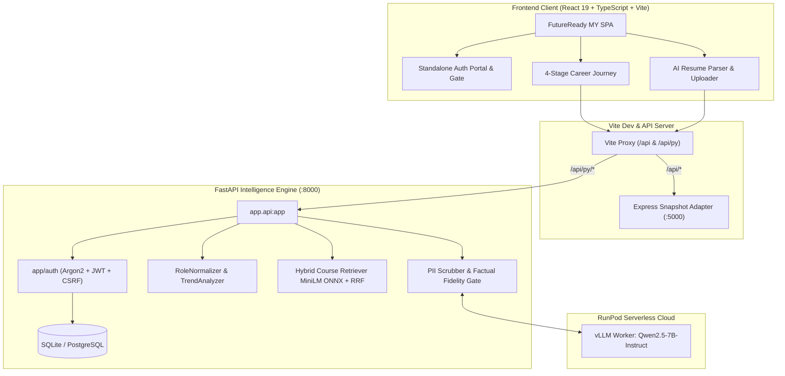

> [!IMPORTANT]
> ## 📁 Submission Documents & Templates
> **All required submission templates are in the Google Drive folder below. Download them before you start.**
>
> ### 👉 [**OPEN THE GOOGLE DRIVE FOLDER**](https://drive.google.com/drive/folders/1xw7c2aN8N-at8hPEULzkcU76e_FFb0Ef) 👈

---

# FutureReady MY — Malaysia Tech Workforce Intelligence Platform

> An empirical, AI-assisted career analytics and upskilling ecosystem that grounds tech career transitions in 63,852 Malaysian job postings and traceable, verified learning pathways for students, job seekers, and career changers.

---

## Team Information

| Field                  | Details                                     |
| ---------------------- | ------------------------------------------- |
| **Team Name**          | Powerstrangers                              |
| **Team Domain**        | Domain 1 – Future-Ready Workforce Domain    |
| **SDG Track (1–17)**   | SDG 4 — Quality Education *(Target 4.4, with secondary alignment to SDG 8 & SDG 9)* |
| **Team Leader**        | Mak Jia Hng                                 |
| **University**         | University of Malaya, University Tunku Abdul Rahman, Xiamen University Malaysia |
| **Number of Members**  | 5                                           |

## Links

| Resource          | Link                                           |
| ----------------- | ---------------------------------------------- |
| GitHub Repository | https://github.com/CJYJas/malaysia-workforce-platform |
| Live Demo         | https://xvu8eu1rakfbfc-8000.proxy.runpod.net   |
| RunPod Endpoint   | https://api.runpod.ai/v2/vllm-qwen2-5-7b/openai/v1 |
| Slide Deck        | https://drive.google.com/drive/folders/1xw7c2aN8N-at8hPEULzkcU76e_FFb0Ef |
| Demo Video        | https://drive.google.com/drive/folders/1xw7c2aN8N-at8hPEULzkcU76e_FFb0Ef |

---

## Overview

### Problem

Malaysia’s technology job seekers, students, and career changers often make upskilling decisions using fragmented information, generic global trend reports, and oversized course catalogues that do not reflect actual local employer demand. This lack of transparency leads learners to spend time and money on mismatched courses without clear evidence of role readiness. This widening mismatch strains Malaysia’s digital economy and limits equitable career mobility for talent without established professional networks.

### Solution

FutureReady MY is an empirical, AI-assisted career analytics and upskilling ecosystem that grounds career transitions in 63,852 deduplicated Malaysian tech job postings and 8,370 authenticated Coursera courses. It provides privacy-first resume extraction (Qwen2.5-7B on RunPod vLLM), deterministic 100-point role-fit matching, and CPU-efficient hybrid semantic course retrieval (MiniLM ONNX + TF-IDF RRF), producing explainable, zero-hallucination learning roadmaps mapped directly to UN SDGs.

### Key Features

- **Empirical Market Evidence & Skills Radar** — Skill shares, demand shifts, and WEF 2025–2030 outlooks derived directly from 63,852 verified Malaysian job postings (zero hallucinated stats).
- **Privacy-First AI Resume Parser** — Open-weight Qwen2.5-7B vLLM extraction with automated Malaysian PII redaction (NRIC, phone, email) and canonical dictionary fallbacks.
- **Explainable 100-Point Role Matching** — Transparent, auditable candidate scoring (75% skill coverage, 15% interests, 10% experience) without black-box generative AI bias.
- **Hybrid Semantic Course Retrieval** — Ultra-fast CPU ONNX dense vector search (`all-MiniLM-L6-v2`) combined with TF-IDF Reciprocal Rank Fusion ($k=60$) over 8,370 courses in <7 ms.
- **Persistent Learning Pathways & Auth** — Argon2id session authentication, persistent checklist progress syncing, and exportable career dossiers.

### Tech Stack

| Layer         | Technology                   |
| ------------- | ---------------------------- |
| Frontend      | React 19, TypeScript, Vite 6, Tailwind CSS v4, Radix UI, TanStack Query |
| Backend       | Python 3.11+, FastAPI 0.109+, Pydantic v2, Uvicorn, Pandas, PyArrow |
| Database      | SQLite (local/dev), PostgreSQL-compatible migrations (SQLAlchemy 2.0 + psycopg 3) |
| AI / Compute  | RunPod Serverless GPU (`Qwen2.5-7B-Instruct` vLLM), CPU ONNX Runtime (`all-MiniLM-L6-v2`) |
| Hosting / Dev | RunPod Cloud (CPU Pod on port 8000) & Replit |

---

## Project Structure

```
.
├── app/                        # FastAPI intelligence engine, auth & business logic
│   ├── api.py                  # Main REST API application entry point & unified router
│   ├── auth/                   # Security, Argon2id, CSRF, and session persistence
│   ├── course_recommender.py   # Hybrid ONNX dense + TF-IDF RRF course retrieval (k=60)
│   ├── resume_parser.py        # PDF extraction, PII scrubber & vLLM client
│   ├── role_matcher.py         # Explainable 100-point role matching algorithm
│   └── trend_analyzer.py       # JobStreet 63k postings empirical market trends
├── data/                       # Audited datasets, parquets, taxonomy & ONNX models
├── docs/                       # Architecture diagrams, benchmark reports, dataset docs
│   ├── ACCOUNT_EXTENSION.md    # Auth & persistence documentation
│   ├── API.md                  # Comprehensive REST API specifications
│   ├── BENCHMARKS.md           # Latency & throughput benchmark reports
│   ├── DATASETS.md             # Dataset auditing, provenance & schemas
│   └── RUNPOD.md               # RunPod serverless & cloud deployment guide
├── frontend/                   # FutureReady MY Client Workspace
│   ├── artifacts/workforce/    # React 19 + TypeScript + Vite SPA client
│   └── artifacts/api-server/   # Express OpenAPI snapshot adapter (:5000)
├── migrations/                 # PostgreSQL & SQLite schema migrations
├── scripts/                    # Preprocessing & retrieval benchmarking scripts
├── submission/                 # SDC Hackathon declaration PDFs & proof of usage
│   ├── SDC2026_Powerstranger_Replit_POU.pdf
│   ├── SDC2026_Powerstranger_Runpod_POU.pdf
│   ├── SDC2026_Powerstranger_TechDeclaration.pdf
│   └── SDC2026_Powerstrangers_Preliminary.pdf
└── tests/                      # 110+ automated pytest backend & security test cases
```

---

## 🏗️ System Architecture



---

## 📊 Dataset Provenance & Empirical Corpus

The platform strictly uses verifiable, publicly auditable datasets:

| Dataset | Source & Link | Total Records | Role in Platform |
| :--- | :--- | :--- | :--- |
| **JobStreet Malaysia Postings** | [Kaggle Dataset](https://www.kaggle.com/datasets/azraimohamad/jobstreet-all-job-dataset) | **63,852** deduplicated | **Primary Market Corpus**: Live baseline for tech skill demand shares, temporal shifts, and role definitions across Malaysia. |
| **Coursera Course Catalog** | [Kaggle Dataset](https://www.kaggle.com/datasets/elvinrustam/coursera-dataset) | **8,370** courses | **Learning Pathway Corpus**: Indexed into 384-dimensional ONNX dense vectors for real-time course recommendations. |
| **IT Skills Taxonomy** | [Kaggle Dataset](https://www.kaggle.com/datasets/meerawks/it-skills-from-jobs) | **3,000** postings | **Canonical Taxonomy**: Seed dictionary for canonical skill resolution and alias mapping. |
| **Techsalerator Sample** | [Kaggle Dataset](https://www.kaggle.com/datasets/techsalerator/job-posting-data-in-malaysia) | **9,919** records | **Audited Baseline**: Audited and confirmed 98.76% non-MY data, verifying JobStreet as the authoritative national dataset. |

*Detailed schema verification and cleaning decisions are documented in [docs/DATASETS.md](./docs/DATASETS.md).*

---

## 🚀 Quickstart Guide & Deployment Options

You can evaluate FutureReady MY either via the **live cloud deployment** or by **running locally on your machine with zero cloud credits**.

### Option 1: Live Cloud Deployment (Instant Evaluation)

* **Live Platform URL**: **[https://xvu8eu1rakfbfc-8000.proxy.runpod.net](https://xvu8eu1rakfbfc-8000.proxy.runpod.net)**
* **No Account Required**: Click **"Continue as Guest Preview"** on the sign-in screen to bypass authentication and explore all features immediately.
* **Pre-configured Cloud Stack**: Hosts the full-stack React 19 client bundled with the FastAPI analytics backend and connected to RunPod Serverless vLLM workers.

---

### Option 2: Running Locally (Offline / Zero-Credit Mode)

If RunPod credits run out, or if you prefer evaluating offline, the entire platform is engineered to run 100% locally on standard CPU hardware with **zero external dependencies and $0 cloud cost**.

#### Method A: Unified Full-Stack Run (Fastest — 1 Terminal)
The backend includes a pre-compiled, optimized production bundle of the React 19 frontend and an embedded snapshot adapter. You only need Python!

```bash
# 1. Clone repository
git clone https://github.com/CJYJas/malaysia-workforce-platform.git
cd malaysia-workforce-platform

# 2. Set up virtual environment
python -m venv venv
# Windows:
.\venv\Scripts\activate
# Linux/macOS:
source venv/bin/activate

# 3. Install Python dependencies
pip install -r requirements.txt

# 4. Start the unified platform (serves Frontend UI + Backend API on port 8000)
uvicorn app.api:app --host 0.0.0.0 --port 8000 --reload
```
Open your browser to: **`http://localhost:8000`** (or view interactive OpenAPI docs at `http://localhost:8000/docs`).

#### Method B: One-Command Docker Run
If you have Docker Desktop installed, run the official pre-built image with a single command:

```bash
docker run -p 8000:8000 jasmine06/malaysia-workforce:latest
```
Open your browser to: **`http://localhost:8000`**.

#### Method C: Developer Mode (Vite Hot-Reloading)
For live frontend code editing:

```bash
# Terminal 1 — Start FastAPI Backend (Port 8000)
uvicorn app.api:app --host 0.0.0.0 --port 8000 --reload

# Terminal 2 — Start Frontend Client with Hot-Reloading (Port 5173)
cd frontend
pnpm install
pnpm --filter @workspace/workforce run dev
```
Open your browser to: **`http://localhost:5173`**.

---

### 🛡️ Zero-Credit & Offline Resilience Guarantee

FutureReady MY does **not** hard-block or fail if RunPod cloud credits are depleted:

1. **Local SQLite Persistence**: Account authentication (Argon2id) and personalized learning checkpoint progress automatically persist in a local SQLite file (`local_dev.db`). No cloud databases required.
2. **CPU-Powered Semantic Search**: Course matching uses a local CPU-optimized ONNX runtime (`all-MiniLM-L6-v2`) paired with TF-IDF Reciprocal Rank Fusion ($k=60$). Vector inference executes entirely on local CPU in **6.9 ms** with $0 cloud spend.
3. **Deterministic Resume Parsing Fallback**: If the RunPod vLLM GPU worker is offline or out of credit, the platform automatically activates its built-in rule-based and regex dictionary extraction pipeline, ensuring resumes are parsed and matched accurately without errors.
4. **Offline Snapshot Corpus**: Complete empirical data for 63,852 JobStreet postings, 8,370 Coursera courses, and UN SDG mappings are stored locally in `app/workforce_data/` and `data/`.

---

## 🎯 Evaluator Walkthrough: Experience the Platform

1. **Dedicated Auth Portal & Gate (`/login` or `/signup`)**:
   * Visit `http://localhost:5173` (or the live URL).
   * Unauthenticated visitors are greeted by the standalone, security-hardened authentication portal.
   * **For Evaluators**: Click **"Continue as Guest Preview"** to explore instantly without registration, or create a quick account with $\ge 12$ character password to test persistent syncing.
2. **AI Resume Parser (`/resume`)**:
   * Upload any tech CV / Resume (PDF).
   * Watch the AI extract canonical skills, compute role readiness, and highlight skill gaps against Malaysian employer benchmarks.
3. **Future Skills Radar (`/radar`)**:
   * Explore rising and declining skill signals categorized by national market velocity and WEF 2025–2030 outlooks.
4. **Role Match Shortlist (`/matches`)**:
   * Test what-if scenario lenses (*Steady Transition*, *Accelerated AI Adoption*, *Human-Centred Transition*).
   * Review explainable 100-point readiness scores with zero black-box ambiguity.
5. **Personalized Action Plan (`/pathway`)**:
   * Inspect ordered curriculum steps linked to authentic Coursera courses.
   * Check off steps (*In Progress*, *Completed*); state persists and reconciles against your verified skills.
   * Export complete pathway data as a JSON career dossier.

---

## 🔒 Security, Ethics & AI Transparency

| Component | Architecture | Guarantee & Safeguard |
| :--- | :--- | :--- |
| **Market Intelligence** | Deterministic Pandas | Strictly frequency-based statistics; never uses generative AI to invent demand numbers. |
| **PII Redaction** | Regex & Boundary Filter | Automatically redacts Malaysian NRIC numbers, phone numbers, emails, and street addresses prior to LLM analysis. |
| **Profile Parsing** | Qwen2.5-7B-Instruct | Post-extraction verification gate discards non-canonical tokens; falls back to dictionary matcher. |
| **Executive Narration** | Qwen2.5-7B-Instruct | Factual fidelity checker ensures all output entities exist in source data; rejects hype words. |
| **User Data & Auth** | Argon2id + CSRF Tokens | Passwords hashed with memory-hard Argon2id; session families rotate on refresh to prevent replay attacks. |

---

## 🧪 Comprehensive Test Suite & Benchmarks

Run the complete verification test suites:

```bash
# 1. Full Backend Test Suite (110+ passing tests)
python -m pytest tests -v

# 2. Auth & Security Verification
python -m pytest tests/test_auth_extension.py -v

# 3. Frontend Contract Tests
cd frontend
pnpm --filter @workspace/scripts run test:account

# 4. Production Bundle Build
pnpm --filter @workspace/workforce run build
```

### Empirical Performance Benchmarks
* **Steady-State Memory**: ~185 MB RAM (optimized for low-cost CPU container deployment).
* **Course Retrieval Latency**: **6.9 ms** hybrid semantic search (vs. 104 ms TF-IDF baseline).
* **Profile Verification Latency**: **1.48 ms** end-to-end.
* **Test Coverage**: 110 passed unit/integration tests with 0 failures.

---

## 👥 Authors & Acknowledgments

* Developed by **Team Powerstrangers** (Mak Jia Hng, Leader)
* Affiliations: University of Malaya, University Tunku Abdul Rahman, Xiamen University Malaysia
* Built with data from [JobStreet Malaysia](https://www.kaggle.com/datasets/azraimohamad/jobstreet-all-job-dataset), [Coursera](https://www.kaggle.com/datasets/elvinrustam/coursera-dataset), and the [World Economic Forum Future of Jobs Report](https://www.weforum.org/).
* Licensed under the [Apache 2.0 License](LICENSE).
