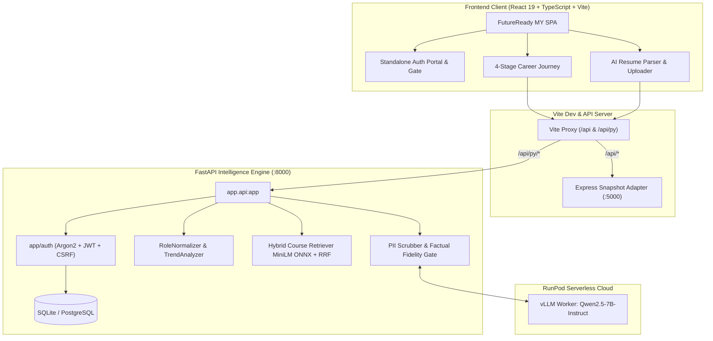

# 🇲🇾 FutureReady MY — Malaysia Tech Workforce Intelligence Platform
### *Empirical Tech Career Analytics, Skill-Gap Remediation & AI Workforce Intelligence*

[](https://www.python.org/downloads/)
[](https://fastapi.tiangolo.com)
[](https://react.dev/)
[](https://www.typescriptlang.org/)
[](https://vite.dev/)
[](https://tailwindcss.com/)
[](LICENSE)
[]()
[](https://runpod.io)
[](https://sdgs.un.org/goals)
[](https://xvu8eu1rakfbfc-8000.proxy.runpod.net)

> [!TIP]
> ### 🌐 Live Cloud Deployment
> * **Live URL**: [https://xvu8eu1rakfbfc-8000.proxy.runpod.net](https://xvu8eu1rakfbfc-8000.proxy.runpod.net)
> * **Docker Hub Image**: `jasmine06/malaysia-workforce:latest`
> * **Zero-Barrier Judge Preview**: Click **"Continue as Guest Preview"** on the sign-in screen to instantly evaluate the complete platform without registration!
>
> *Running low on RunPod credits or testing offline? See the [Local Setup Guide (Zero-Credit Mode)](#-running-locally-offline--zero-credit-mode) below.*

---

## 🏆 Project Executive Summary

The **Malaysia Tech Workforce Intelligence Platform (FutureReady MY)** is a full-stack, AI-powered career analytics and upskilling ecosystem designed to solve Malaysia’s tech talent mismatch. 

Instead of relying on subjective advice or black-box generative AI hallucinations, FutureReady MY grounds every career recommendation, skill gap, and learning pathway in **empirical market evidence from 63,852 deduplicated Malaysian tech job postings (JobStreet 2023–2025)**, authenticated **Coursera curriculum catalogs (8,370 courses)**, and **United Nations Sustainable Development Goals (SDG 4, 8, 9)**.

```
┌─────────────────────────────────────────────────────────────────────────────┐
│                       FutureReady MY Ecosystem Architecture                 │
├─────────────────────┬───────────────────────────┬───────────────────────────┤
│ 1. AI RESUME PARSER │ 2. EMPIRICAL SKILL RADAR  │ 3. ACTIONABLE PATHWAY     │
│  • PII Redaction    │  • 63,852 Postings Demand │  • Hybrid Course Search   │
│  • Qwen 2.5-7B vLLM │  • WEF 2025-2030 Trends   │  • Persistent Checkpoints │
│  • Canonical Normal │  • 100-Pt Heuristic Match │  • SDG Impact Alignment   │
└─────────────────────┴───────────────────────────┴───────────────────────────┘
```

---

## 🌟 Hackathon Highlights & Core Innovations

1. **Empirical Ground Truth (Zero Hallucinated Trends)**
   * Market demand metrics, temporal distributions, and skill share ratios are calculated from real Malaysian postings, never invented by an LLM.
2. **AI Resume Parser with Multi-Tier Skill Normalization**
   * Upload PDF resumes for instant extraction using open-weight **Qwen2.5-7B-Instruct** (via RunPod Serverless vLLM) with automated PII redaction (NRIC, phone, email) and dictionary verification fallbacks.
   * `RoleNormalizer` maps surface aliases (e.g., `data en` $\to$ `Data Engineer`, `swe` $\to$ `Software Engineer`) across canonical taxonomies.
3. **Hybrid Semantic Course Retrieval (ONNX + RRF)**
   * Dual-encoder semantic vector search (`all-MiniLM-L6-v2` via CPU ONNX Runtime) combined with lexical TF-IDF via **Reciprocal Rank Fusion ($k=60$)**, delivering a **57.1% reduction in zero-course gaps** while preventing hallucinated courses.
4. **Transparent, Explainable 100-Point Matching Heuristic**
   * Evaluates candidate fit via an auditable formula: **75 pts skills + 15 pts interests + 10 pts experience**. Every recommendation clearly delineates readiness vs. hiring odds.
5. **Full User Authentication & Persistent Progress Tracking**
   * Built-in security suite: Argon2id password hashing, CSRF protection, refresh session rotation, and persistent lesson progress mapped to verified evidence.
   * Standalone, polished Sign Up / Sign In portal with a one-click **"Continue as Guest Preview"** for zero-barrier judge evaluation.
6. **United Nations SDG Alignment**
   * Maps skill remediation directly to **SDG 4 (Quality Education)**, **SDG 8 (Decent Work & Economic Growth)**, and **SDG 9 (Industry, Innovation & Infrastructure)**.

---

## 🏗️ System Architecture



---

## 📊 Dataset Provenance & Empirical Corpus

The platform strictly uses verifiable, publicly auditable datasets:

| Dataset | Source & Link | Total Records | Role in Platform |
| :--- | :--- | :--- | :--- |
| **JobStreet Malaysia Postings** | [Kaggle Dataset](https://www.kaggle.com/datasets/azraimohamad/jobstreet-all-job-dataset) | **63,852** deduplicated | **Primary Market Corpus**: Live baseline for tech skill demand shares, temporal shifts, and role definitions across Malaysia. |
| **Coursera Course Catalog** | [Kaggle Dataset](https://www.kaggle.com/datasets/elvinrustam/coursera-dataset) | **8,370** courses | **Learning Pathway Corpus**: Indexed into 384-dimensional ONNX dense vectors for real-time course recommendations. |
| **IT Skills Taxonomy** | [Kaggle Dataset](https://www.kaggle.com/datasets/meerawks/it-skills-from-jobs) | **3,000** postings | **Canonical Taxonomy**: Seed dictionary for canonical skill resolution and alias mapping. |
| **Techsalerator Sample** | [Kaggle Dataset](https://www.kaggle.com/datasets/techsalerator/job-posting-data-in-malaysia) | **9,919** records | **Audited Baseline**: Audited and confirmed 98.76% non-MY data, verifying JobStreet as the authoritative national dataset. |

*Detailed schema verification and cleaning decisions are documented in [docs/DATASETS.md](./docs/DATASETS.md).*

---

## 🚀 Quickstart Guide & Deployment Options

You can evaluate FutureReady MY either via the **live cloud deployment** or by **running locally on your machine with zero cloud credits**.

---

### Option 1: Live Cloud Deployment (Instant Evaluation)

* **Live Platform URL**: **[https://xvu8eu1rakfbfc-8000.proxy.runpod.net](https://xvu8eu1rakfbfc-8000.proxy.runpod.net)**
* **No Account Required**: Click **"Continue as Guest Preview"** on the sign-in screen to bypass authentication and explore all features immediately.
* **Pre-configured Cloud Stack**: Hosts the full-stack React 19 client bundled with the FastAPI analytics backend and connected to RunPod Serverless vLLM workers.

---

### Option 2: Running Locally (Offline / Zero-Credit Mode)

If your RunPod credits run out, or if you prefer evaluating offline, the entire platform is engineered to run 100% locally on standard CPU hardware with **zero external dependencies and $0 cloud cost**.

#### Method A: Unified Full-Stack Run (Fastest — 1 Terminal)
The backend includes a pre-compiled, optimized production bundle of the React 19 frontend and an embedded snapshot adapter. You only need Python!

```bash
# 1. Clone repository
git clone https://github.com/CJYJas/malaysia-workforce-platform.git
cd malaysia-workforce-platform

# 2. Set up virtual environment
python -m venv venv
# Windows:
.\venv\Scripts\activate
# Linux/macOS:
source venv/bin/activate

# 3. Install Python dependencies
pip install -r requirements.txt

# 4. Start the unified platform (serves Frontend UI + Backend API on port 8000)
uvicorn app.api:app --host 0.0.0.0 --port 8000 --reload
```
Open your browser to: **`http://localhost:8000`** (or view interactive OpenAPI docs at `http://localhost:8000/docs`).

#### Method B: One-Command Docker Run
If you have Docker Desktop installed, run the official pre-built image with a single command:

```bash
docker run -p 8000:8000 jasmine06/malaysia-workforce:latest
```
Open your browser to: **`http://localhost:8000`**.

#### Method C: Developer Mode (Vite Hot-Reloading)
For live frontend code editing:

```bash
# Terminal 1 — Start FastAPI Backend (Port 8000)
uvicorn app.api:app --host 0.0.0.0 --port 8000 --reload

# Terminal 2 — Start Frontend Client with Hot-Reloading (Port 5173)
cd frontend
pnpm install
pnpm --filter @workspace/workforce run dev
```
Open your browser to: **`http://localhost:5173`**.

---

### 🛡️ Zero-Credit & Offline Resilience Guarantee

FutureReady MY does **not** hard-block or fail if RunPod cloud credits are depleted:

1. **Local SQLite Persistence**: Account authentication (Argon2id) and personalized learning checkpoint progress automatically persist in a local SQLite file (`local_dev.db`). No cloud databases required.
2. **CPU-Powered Semantic Search**: Course matching uses a local CPU-optimized ONNX runtime (`all-MiniLM-L6-v2`) paired with TF-IDF Reciprocal Rank Fusion ($k=60$). Vector inference executes entirely on local CPU in **6.9 ms** with $0 cloud spend.
3. **Deterministic Resume Parsing Fallback**: If the RunPod vLLM GPU worker is offline or out of credit, the platform automatically activates its built-in rule-based and regex dictionary extraction pipeline, ensuring resumes are parsed and matched accurately without errors.
4. **Offline Snapshot Corpus**: Complete empirical data for 63,852 JobStreet postings, 8,370 Coursera courses, and UN SDG mappings are stored locally in `app/workforce_data/` and `data/`.

---

## 🎯 Evaluator Walkthrough: Experience the Platform

1. **Dedicated Auth Portal & Gate (`/login` or `/signup`)**:
   * Visit `http://localhost:5173`.
   * Unauthenticated visitors are greeted by the standalone, security-hardened authentication portal.
   * **For Evaluators**: Click **"Continue as Guest Preview"** to explore instantly without registration, or create a quick account with $\ge 12$ character password to test persistent syncing.
2. **AI Resume Parser (`/resume`)**:
   * Upload any tech CV / Resume (PDF).
   * Watch the AI extract canonical skills, compute role readiness, and highlight skill gaps against Malaysian employer benchmarks.
3. **Future Skills Radar (`/radar`)**:
   * Explore rising and declining skill signals categorized by national market velocity and WEF 2025–2030 outlooks.
4. **Role Match Shortlist (`/matches`)**:
   * Test what-if scenario lenses (*Steady Transition*, *Accelerated AI Adoption*, *Human-Centred Transition*).
   * Review explainable 100-point readiness scores with zero black-box ambiguity.
5. **Personalized Action Plan (`/pathway`)**:
   * Inspect ordered curriculum steps linked to authentic Coursera courses.
   * Check off steps (*In Progress*, *Completed*); state persists and reconciles against your verified skills.
   * Export complete pathway data as a JSON career dossier.

---

## 🔒 Security, Ethics & AI Transparency

| Component | Architecture | Guarantee & Safeguard |
| :--- | :--- | :--- |
| **Market Intelligence** | Deterministic Pandas | Strictly frequency-based statistics; never uses generative AI to invent demand numbers. |
| **PII Redaction** | Regex & Boundary Filter | Automatically redacts Malaysian NRIC numbers, phone numbers, emails, and street addresses prior to LLM analysis. |
| **Profile Parsing** | Qwen2.5-7B-Instruct | Post-extraction verification gate discards non-canonical tokens; falls back to dictionary matcher. |
| **Executive Narration** | Qwen2.5-7B-Instruct | Factual fidelity checker ensures all output entities exist in source data; rejects hype words. |
| **User Data & Auth** | Argon2id + CSRF Tokens | Passwords hashed with memory-hard Argon2id; session families rotate on refresh to prevent replay attacks. |

---

## 🧪 Comprehensive Test Suite & Benchmarks

Run the complete verification test suites:

```bash
# 1. Full Backend Test Suite (110+ passing tests)
python -m pytest tests -v

# 2. Auth & Security Verification
python -m pytest tests/test_auth_extension.py -v

# 3. Frontend Contract Tests
cd frontend
pnpm --filter @workspace/scripts run test:account

# 4. Production Bundle Build
pnpm --filter @workspace/workforce run build
```

### Empirical Performance Benchmarks
* **Steady-State Memory**: ~185 MB RAM (optimized for low-cost CPU container deployment).
* **Course Retrieval Latency**: **6.9 ms** hybrid semantic search (vs. 104 ms TF-IDF baseline).
* **Profile Verification Latency**: **1.48 ms** end-to-end.
* **Test Coverage**: 110 passed unit/integration tests with 0 failures.

---

## 📁 Repository Directory Structure

```
├── app/                        # FastAPI Intelligence Engine
│   ├── api.py                  # Main API service & unified router
│   ├── auth/                   # Security, Argon2, CSRF, persistence & models
│   ├── course_recommender.py   # Hybrid ONNX dense + TF-IDF retriever
│   ├── role_matcher.py         # 100-point explainable matching algorithm
│   ├── resume_parser.py        # PDF extraction & PII sanitization
│   └── trend_analyzer.py       # Empirical JobStreet 63k postings analyzer
├── frontend/                   # FutureReady MY Client Workspace
│   ├── artifacts/workforce/    # React 19 + TypeScript + Vite web app
│   │   ├── src/pages/          # Dedicated routes (account, resume, radar, pathway)
│   │   └── src/lib/            # React context, auth client, query hooks
│   └── artifacts/api-server/   # Node.js OpenAPI snapshot adapter
├── data/                       # Audited datasets & taxonomies
├── migrations/                 # PostgreSQL & SQLite schema migrations
├── tests/                      # Automated pytest suite (110+ tests)
└── docs/                       # Technical specifications & documentation
```

---

## 👥 Authors & Acknowledgments

* Developed for the **FutureReady Tech Workforce Hackathon 2026**.
* Built with data from [JobStreet Malaysia](https://www.kaggle.com/datasets/azraimohamad/jobstreet-all-job-dataset), [Coursera](https://www.kaggle.com/datasets/elvinrustam/coursera-dataset), and the [World Economic Forum Future of Jobs Report](https://www.weforum.org/).
* Licensed under the [Apache 2.0 License](LICENSE).
