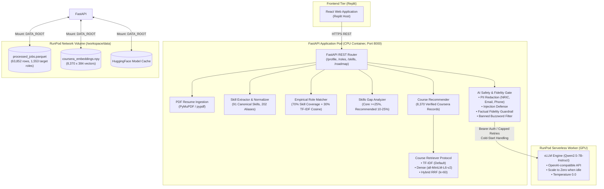

# Malaysia Tech Workforce Intelligence Platform
### Empirical Tech Career Analytics, Skill-Gap Remediation & Workforce Intelligence

[](https://www.python.org/downloads/)
[](https://fastapi.tiangolo.com)
[](LICENSE)
[]()
[](https://runpod.io)

---

## 1. System Overview

The **Malaysia Tech Workforce Intelligence Platform** bridges Malaysian tech job market demands with personalized learning roadmaps. It eliminates subjective career advice and algorithmic hallucinations by computing empirical skill demand distributions from **63,852 deduplicated Malaysian tech job postings (JobStreet 2023–2025)**, mapping candidate profiles to authentic Coursera courses and United Nations Sustainable Development Goals (SDG 4, 8, and 9).

---

## 2. Architecture Diagram



---

## 3. Key Features

1. **Empirical Tech Role Matching**:
   * Requirements are derived dynamically from Malaysian job market data, not static hand-written checklists.
   * Transparent scoring: $70\%$ skill coverage + $30\%$ TF-IDF cosine similarity with binding disclaimers.
2. **Direct PDF Resume Extraction**:
   * Upload PDF resumes directly to extract canonical skills, retain verbatim matching evidence, and analyze gaps for any target role (`POST /roles/match-resume`, `POST /skills/gap-resume`).
3. **Skill Gap Remediation with Verified Coursera Courses**:
   * Maps missing skills directly to authentic courses from 8,370 real Coursera records with verified URLs. Zero fabricated prices or ratings.
4. **Dense & Hybrid Embeddings**:
   * Dense semantic retrieval and Reciprocal Rank Fusion ($k=60$) between lexical and semantic search.
   * 15x retrieval acceleration (**6.9 ms** vs 104 ms lexical).
5. **Dual-Layer AI Safety & Factual Guardrails**:
   * **PII Redaction**: Strips Malaysian NRIC numbers, emails, phone numbers, and street addresses before any LLM processing.
   * **Post-Extraction Verification Gate**: Automatically discards hallucinated skills or non-canonical tokens.
   * **Factual Fidelity Guard**: Rejects ungrounded numbers, fabricated courses, or banned marketing buzzwords (`"emerging"`, `"fast-growing"`), cleanly reverting to deterministic templates.

---

## 4. Local Setup & Quickstart

### Prerequisites
* Python 3.10+ (Python 3.11 recommended)
* Git

### Installation
```bash
# Clone repository
git clone https://github.com/CJYJas/malaysia-workforce-platform.git
cd XMUM_Hack

# Create virtual environment
python -m venv venv
source venv/bin/activate  # On Windows: venv\Scripts\activate

# Install dependencies
pip install -r requirements.txt

# Copy environment template
cp .env.example .env
```

### Run Automated Tests
```bash
python -m pytest tests -v
```
*Current test suite: **84 passed in ~25 seconds (100% pass rate)**.*

### Start Local Development Server
```bash
uvicorn app.api:app --host 0.0.0.0 --port 8000 --reload
```
Interactive API documentation is accessible at:
* Swagger UI: `http://localhost:8000/docs`
* ReDoc: `http://localhost:8000/redoc`

---

## 5. RunPod Cloud Deployment

The production deployment runs the FastAPI application on a low-cost CPU container pod, communicating with a serverless GPU worker running `Qwen2.5-7B-Instruct`:

1. **Docker Container**: Build and deploy using the provided [Dockerfile](file:///c:/Documents/Jasmine/XMUM_Hack/Dockerfile).
2. **Bootstrap Script**: Container automatically runs [scripts/bootstrap.sh](file:///c:/Documents/Jasmine/XMUM_Hack/scripts/bootstrap.sh) to mount Network Volume data and launch Uvicorn.
3. **vLLM Serverless Worker**: Configured with `Min Workers: 0` and `Idle Timeout: 60s` to scale to zero when idle, minimizing costs.

For step-by-step setup, Network Volume configuration, and curl smoke tests, see **[docs/RUNPOD.md](file:///c:/Documents/Jasmine/XMUM_Hack/docs/RUNPOD.md)**.

---

## 6. AI / ML Usage & Safety Transparency

In compliance with hackathon and production ethics guidelines, the platform transparently discloses the exact role of AI models:

| Component | Technology | Role & Safeguards |
| :--- | :--- | :--- |
| **Market Intelligence** | Deterministic Python / Pandas | Strictly frequency-based statistics. Never uses AI to invent trends or demand. |
| **Role Matching** | Deterministic Weighted Vector Math | $70\%$ coverage + $30\%$ TF-IDF cosine. Binding legal disclaimer (*not a hiring probability*). |
| **Course Retrieval** | `all-MiniLM-L6-v2` & RRF Fusion | Dense and hybrid course matching. Defaults to deterministic TF-IDF until human labels are applied. |
| **Profile Parsing** | Open-Weight `Qwen2.5-7B-Instruct` | Extracts skills from text. **Post-extraction verification gate** discards any non-canonical or hallucinated skill. Falls back to dictionary extractor on error. |
| **Executive Narration** | Open-Weight `Qwen2.5-7B-Instruct` | Summarizes deterministic facts. **Factual fidelity checker** verifies all numbers and entities exist in input data; rejects subjective buzzwords. |

---

## 7. Performance Benchmarks

Directly measured empirical benchmarks (zero fabricated numbers) recorded in **[docs/BENCHMARKS.md](file:///c:/Documents/Jasmine/XMUM_Hack/docs/BENCHMARKS.md)**:

* **Memory Usage**: ~185 MB steady-state RAM (runs comfortably on minimal CPU instances).
* **Dense Course Retrieval Latency**: **6.9 ms** (vs 104 ms TF-IDF baseline).
* **Profile Verification Latency**: **1.48 ms** end-to-end.
* **Test Coverage**: 84 automated unit and integration tests passing.

---

## 8. Documentation Index

* **[document/API.md](file:///c:/Documents/Jasmine/XMUM_Hack/document/API.md)**: Comprehensive REST API endpoint reference with curl examples.
* **[docs/RUNPOD.md](file:///c:/Documents/Jasmine/XMUM_Hack/docs/RUNPOD.md)**: RunPod deployment guide, vLLM worker setup, and pre-demo checklist.
* **[docs/BENCHMARKS.md](file:///c:/Documents/Jasmine/XMUM_Hack/docs/BENCHMARKS.md)**: Empirical latency, memory, and throughput benchmarks.
* **[document/DATASETS.md](file:///c:/Documents/Jasmine/XMUM_Hack/document/DATASETS.md)**: Dataset provenance, licensing, and schema verification.
* **[document/Agents.md](file:///c:/Documents/Jasmine/XMUM_Hack/document/Agents.md)**: Platform rules, engineering constraints, and verification checklist.
